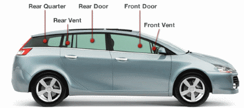

## Solicita Tu Cotización

  

    Jomar Auto Glass ofrece cambio de cristales para carros en Puerto Rico con los mejores precios y servicio garantizado. Completa el formulario a continuación para recibir una cotización profesional.
  

  

    Te responderemos pronto con opciones de precio, disponibilidad de citas y detalles sobre nuestros servicios. También puedes llamar directamente o enviarnos una foto de tu vehículo.
  

<form name="precioporpagina" id="precioporpagina" onsubmit="myButton.disabled = true; return true;" data-netlify="true" method="post" action="{{ site.baseurl }}/cotizacion_response/index.html">
	<input type="hidden" name="data-netlify" value="true" />
	<input type="hidden" name="Fecha" id="Fecha" />

	<fieldset>
	<legend>Su información</legend>	
	

		<label for="Nombre">Nombre:</label>
		<input type="text" name="Nombre" id="Nombre" autofocus="true" />
	

	

		<label for="Correo_Electronico">Correo Electrónico: *</label>
		<input type="email" name="Correo_Electronico"  id="Correo_Electronico" required 
			oninvalid="this.setCustomValidity('Por favor, escriba su correo electrónico.')" 
			oninput="setCustomValidity('')" >
	

	

		<label for="Telefono">Teléfono:</label>
		<input type="tel" name="Telefono" id="Telefono" />
	

	
 
		<label for="Localizado" style="width: 100%;">¿En que pueblo o ciudad está el auto localizado?</label>
		<textarea name="Localizado" id="Localizado" style="width:90%; height:60px"></textarea>
	

	</fieldset>

	 Jomar Auto Glass ofrece reemplazo de vidrios para autos y camiones. 

	<fieldset>
	<legend>Su Auto</legend>	
	

		<label for="Ano">Año del Auto: *</label>
		<input type="text" name="Ano" id="Ano" required 
			oninvalid="this.setCustomValidity('Por favor, escriba el año de su auto.')" 
			oninput="setCustomValidity('')" >  
	

	

		<label for="Marca">Marca: *</label>
		<input type="text" name="Marca" id="Marca" required 
			oninvalid="this.setCustomValidity('Por favor, escriba la marca de su auto.')" 
			oninput="setCustomValidity('')" >
	

	

		<label for="Modelo">Modelo: *</label>
		<input type="text" name="Modelo" id="Modelo" required 
			oninvalid="this.setCustomValidity('Por favor, escriba el modelo de su auto.')" 
			oninput="setCustomValidity('')" >
	

	

		<label for="Delante_Tracero_Otro" style="vertical-align: top">¿Delantero, tracero? *</label>
		<select name="Delante_Tracero_Otro" id="Delante_Tracero_Otro" size="4" required 
			oninvalid="this.setCustomValidity('Por favor, indique que cristal está roto.')" 
			oninput="setCustomValidity('')" >
			<option value="Delantero">Delantero</option>
			<option value="Tracero">Tracero</option>
			<option value="Izquierdo">Izquierdo</option>
			<option value="Derecho">Derecho</option>
		</select>
	

	

		 ¿Número de puertas? 
		<input type="radio" name="Numero_Puertas" value="Dos Puertas" style="width: 40px;">Dos
		<input type="radio" name="Numero_Puertas" value="Cuatro Puertas" style="width: 40px;">Cuatro
		<input type="checkbox" name="Hatchback" value="Si " style="width: 40px;">Hatchback? 
	

	

		 ¿Si escogió lado izquierdo o derecho, cual es su cristal roto?
	

	

		

			<input type="radio" name="Cristal_Roto" value="Rear Quarter" style="width: 40px;">Rear Quarter 
			<input type="radio" name="Cristal_Roto" value="Rear Vent" style="width: 40px;">Rear Vent 
			<input type="radio" name="Cristal_Roto" value="Rear Door" style="width: 40px;">Rear Door 
			<input type="radio" name="Cristal_Roto" value="Front Door" style="width: 40px;">Front Door 
			<input type="radio" name="Cristal_Roto" value="Front Vent" style="width: 40px;">Front Vent  
			<input type="radio" name="Cristal_Roto" value="Tengo Duda" style="width: 40px;">Tengo Duda 
			&nbsp; &nbsp; &nbsp; (Explique abajo) 
		

		
 
			
		

	

	
 
		<label for="Informacion_Adicional" style="width: 100%;">Información Adicional</label>
		<textarea name="Informacion_Adicional" id="Informacion_Adicional" style="width:90%; height:60px"></textarea>
	

	</fieldset>
	

		

		<button type="submit" value="submit" name="myButton" class="bg-accent hover:bg-red-700 text-white font-heading font-bold py-3 px-8 rounded-lg transition uppercase tracking-wide">Enviar Cotización</button>
	

</form>

---

## Otras Formas De Contactarnos

  

    <h3 class="font-heading font-bold text-lg text-primary mb-3">📧 Por Email</h3>
    

      Envía una foto de tu carro con el cristal roto a:
    

    <a href="mailto:{{ site.email }}" class="inline-block bg-accent hover:bg-red-700 text-white font-heading font-bold py-2 px-4 rounded transition text-sm">
      {{ site.email }}
    </a>
    

      Pronto te devolveremos tu mensaje con detalles.
    

  

  

    <h3 class="font-heading font-bold text-lg text-primary mb-3">📞 Por Teléfono</h3>
    

      Llama directamente para hablar con nuestro equipo:
    

    <a href="tel:{{ site.phones-link }}" class="inline-block bg-accent hover:bg-red-700 text-white font-heading font-bold py-2 px-4 rounded transition text-sm">
      {{ site.phones }}
    </a>
    

      Disponibles para responder todas tus preguntas.
    

  

